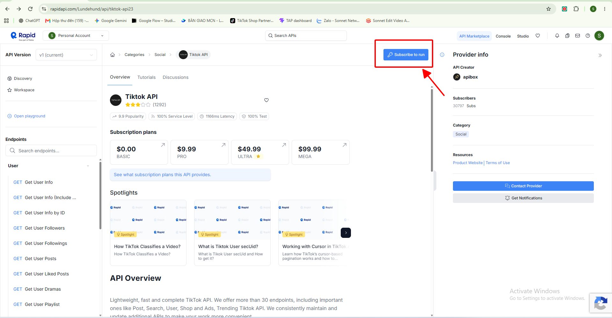
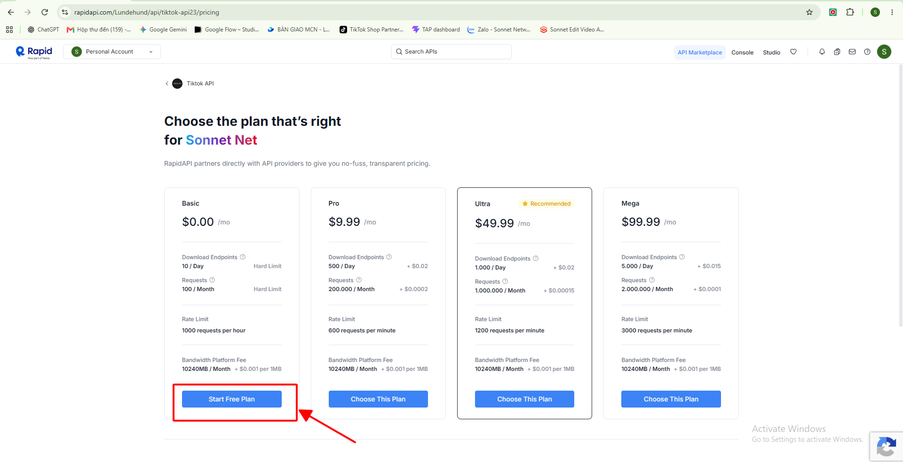
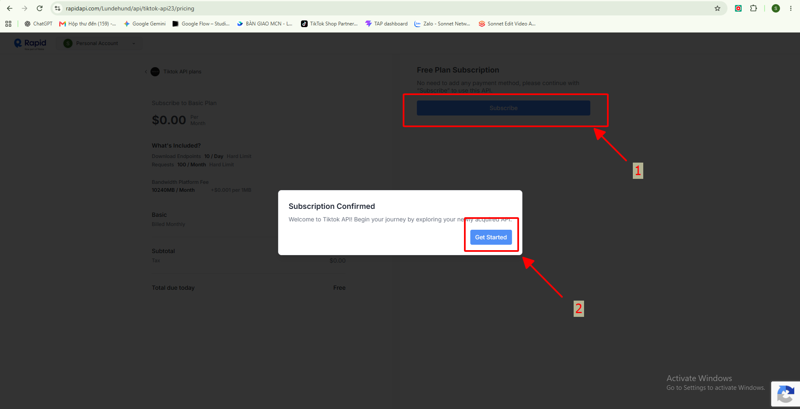
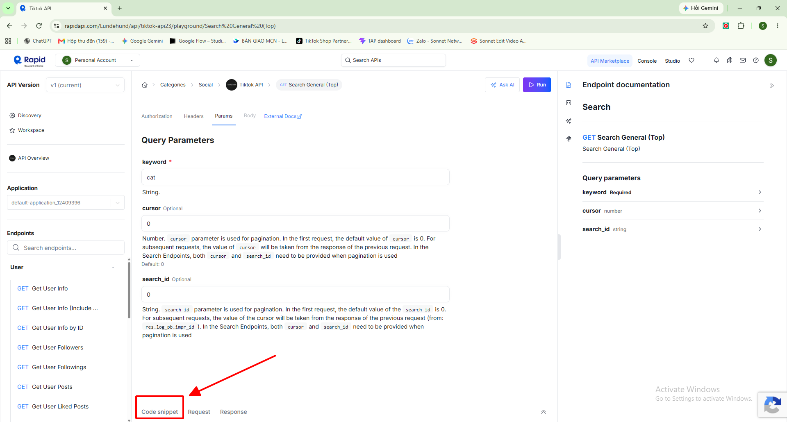
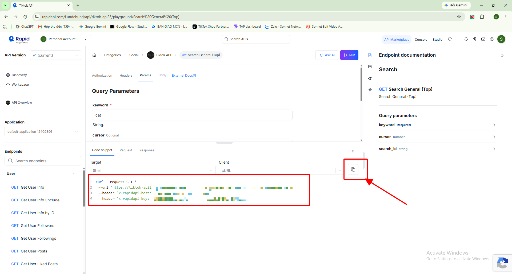

# Hướng dẫn kết nối chi tiết (tài liệu tham khảo cho Claude, có ảnh thật)

**Khi nào đọc file này:** người dùng bị kẹt ở bất kỳ bước kết nối nào trong SKILL.md, hoặc lần đầu hướng dẫn một người hoàn toàn chưa biết RapidAPI là gì. Hướng dẫn **từng bước một**, chờ họ báo xong rồi mới sang bước sau, câu ngắn, giả định họ không biết gì về API/key. Ảnh trong thư mục `images/` chụp đúng giao diện RapidAPI hiện tại (kiểm chứng ngày 24/10/2026) — gửi ảnh tương ứng cho người dùng ở mỗi bước nếu họ cần xem trực quan.

**Giải thích ngắn gọn cho người mới (nếu họ hỏi "cái này là gì"):** RapidAPI là một "chợ" bán quyền truy cập vào các API — ở đây là API lấy dữ liệu TikTok. "Subscribe" (đăng ký gói) giống như đăng ký dùng thử một dịch vụ. "API key" là một chuỗi ký tự giống mật khẩu riêng, dùng để chứng minh "tôi được phép gọi API này" — ai có key người đó gọi được, nên **không chia sẻ key cho người lạ, không dán vào khung chat với Claude**.

---

## B1. Tạo tài khoản RapidAPI

1. Mở trình duyệt, vào: https://rapidapi.com/Lundehund/api/tiktok-api23
2. Góc trên bên phải có 2 nút: **Log In** và **Sign Up**.
   - Chưa có tài khoản → **Sign Up** → có thể chọn "Continue with Google" (nhanh nhất nếu có sẵn Gmail) hoặc đăng ký bằng email.
   - Đã có tài khoản → **Log In**.
3. Nếu RapidAPI yêu cầu xác minh email → mở hộp thư, bấm link xác minh, quay lại tab RapidAPI.

**Lỗi hay gặp:** đăng ký bằng email nhưng không thấy thư xác minh → kiểm tra thư mục Spam/Quảng cáo.

## B2. Bấm Subscribe

Ở trang API, góc trên bên phải có nút xanh dương **"Subscribe to run"**.



Bấm vào đó → chuyển sang trang chọn gói.

## B3. Chọn gói BASIC (miễn phí)

Trang hiện 4 gói: **BASIC $0.00**, PRO $9.99, ULTRA $49.99, MEGA $99.99. Gói BASIC cho **100 request/tháng, 10 lượt download/ngày** — đủ để dùng thử và test.



Bấm **"Start Free Plan"** (nút dưới cột BASIC, bên trái) → không cần nhập thẻ.

## B4. Xác nhận

Một hộp thoại "Subscription Confirmed" hiện ra, xác nhận đã có quyền dùng API.



Bấm **"Get Started"** → trang tự chuyển vào Playground của API.

## B5. Mở tab Code snippet

Ở trang Playground, chọn 1 endpoint bất kỳ bên sidebar trái (vd "Get User Info"), cuộn xuống dưới sẽ thấy 3 tab: **Code snippet** / Request / Response.



Bấm vào **"Code snippet"**.

## B6. Copy API key

Trong khung code (mặc định dạng cURL) có 2 dòng:
```
--header 'x-rapidapi-host: tiktok-api23.p.rapidapi.com'
--header 'x-rapidapi-key: ...chuỗi ký tự dài...'
```



Bấm **icon copy** (ô vuông nhỏ góc trên phải khung code) để copy nguyên cả đoạn code — hoặc bôi đen thủ công chỉ phần sau `x-rapidapi-key:` nếu muốn copy đúng mỗi key.

**Nếu copy nguyên cả đoạn code:** không sao, khi dán vào file `key.txt` ở bước B7, Claude/script chỉ cần đúng chuỗi key — báo Claude biết đã copy cả đoạn để Claude tách đúng chuỗi key trước khi dùng (hoặc người dùng tự bôi đen lại cho gọn, chỉ lấy phần sau `x-rapidapi-key:`, trước dấu `'` đóng).

## B7. Dán key vào máy

**Người dùng không bao giờ dán key vào khung chat với Claude** — chỉ dán vào file Notepad do script mở ra, giữ trên máy họ.

1. Claude chạy (đổi `python` thành `py` hoặc `python3` nếu máy cần, xem B0):
   ```
   python "<skill>/scripts/tiktok_api.py" --setup-key
   ```
2. Cửa sổ Notepad (Windows) hoặc TextEdit (Mac) hiện ra, trống rỗng.
3. Người dùng dán key (Ctrl+V / Cmd+V) — chỉ đúng chuỗi key, không kèm chữ `x-rapidapi-key:`.
4. Lưu file (Ctrl+S / Cmd+S), đóng cửa sổ.
5. Báo lại Claude: "xong rồi" / "dán rồi".

## B8. Kiểm tra

Claude chạy:
```
python "<skill>/scripts/tiktok_api.py" --check-key
```
- In ra `KEY OK` → xong, có thể gọi bất kỳ endpoint nào trong skill.
- Báo lỗi → xem mục dưới đây.

---

## B0. Xác định lệnh Python đúng trên máy đó

Một số máy Windows gõ `python` sẽ tự mở Microsoft Store thay vì chạy Python thật (do "App execution alias" của Windows) — đây không phải lỗi của skill.

1. Thử: `python --version`
2. Không ra số phiên bản (vd `Python 3.12.1`) hoặc tự mở Store → thử `py --version`
3. Vẫn không được → thử `python3 --version`
4. Có 1 trong 3 lệnh chạy ra số phiên bản → dùng đúng lệnh đó thay cho `python` trong **mọi** lệnh ở SKILL.md cho người này.
5. Không lệnh nào chạy được → máy chưa cài Python. Hướng dẫn: vào https://www.python.org/downloads/ → tải bản mới nhất → khi cài, **bắt buộc tick ô "Add python.exe to PATH"** ở màn hình đầu tiên của bộ cài → Install Now → cài xong mở lại cửa sổ lệnh, thử lại bước 1.

## Các lỗi khi gọi API (sau khi đã kết nối xong)

- **`KEY SAI hoặc chưa subscribe` kèm `HTTP 403 ... error code: 1010`**: đây là Cloudflare chặn do thiếu header trình duyệt — skill đã tự gửi kèm `User-Agent` giả lập, nếu vẫn gặp lỗi này thì báo lại để kiểm tra bản script có phải bản mới nhất không.
- **HTTP 401 thật (unauthorized)**: key copy thiếu/thừa ký tự (dính khoảng trắng, dính dấu nháy `'`), hoặc copy nhầm giá trị `x-rapidapi-host` thay vì `x-rapidapi-key`. Chạy lại `--setup-key`, xóa hết, dán lại key cho chắc.
- **HTTP 429 (`exceeded`, `Too Many Requests`)**: hết hạn mức gói trong tháng (BASIC: 100 request/tháng, 10 download/ngày). Đợi sang tháng hoặc nâng gói (PRO/ULTRA/MEGA) tại tab Pricing của API.
- **Một số endpoint trả về rỗng dù key đúng** (script in ra `"_empty": true`): HTTP 204 từ phía nhà cung cấp — đã gặp thực tế ở nhóm `search/*` (vd `search-general`, `search-video`) ngày 24/10/2026, trong khi `user-info`, `trending-ads` vẫn trả dữ liệu bình thường. Không phải lỗi kết nối — thử endpoint/tham số khác, hoặc coi là giới hạn tạm thời của nhà cung cấp.
- **Không tìm thấy nút Subscribe / không thấy Code snippet**: trình duyệt chặn JavaScript hoặc trang chưa load xong — tải lại trang (F5), thử trình duyệt khác (Chrome/Edge) nếu vẫn không thấy.
- **Không có mạng / timeout**: máy không có kết nối Internet hoặc tường lửa công ty chặn `rapidapi.com`/`*.p.rapidapi.com` — thử mạng khác hoặc hỏi IT nội bộ.
